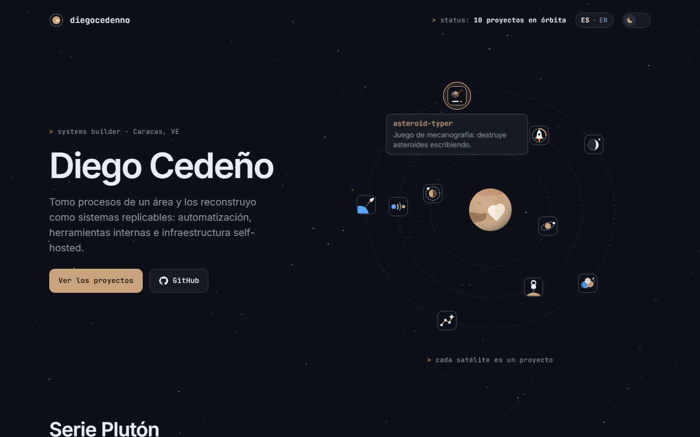

# diegocedenno.github.io

> My portfolio: an orbital map where every project of the Plutón series is a satellite you can open, plus the rest of my work.
>
> Mi portafolio: un mapa orbital donde cada proyecto de la serie Plutón es un satélite que puedes abrir, más el resto de mi trabajo.

**[Live site · Sitio en vivo →](https://diegocedenno.github.io/)**

**[English](#english)** · **[Español](#español)**

---

## English

### What it is

- A home page for my GitHub work. Pluto sits in the middle and every project of the Plutón series orbits it as a satellite: hover, tap or Tab to see what it is, click to open its live demo.
- Below the map, the same projects as cards with a screenshot, a one-line description, a link to the demo and a link to the code, filterable by kind (tools, simulators, games).
- Spanish and English, switchable from the header and remembered. Light and dark themes, shared with the rest of the series.

### What makes it technically interesting

- **One catalog, many outputs.** The project list is not written by hand: a small script reads the series catalog, copies each project's favicon as its map icon, shrinks its README screenshot into a thumbnail and writes `js/data.js`. Adding a project to the series adds it here.
- **One animation loop, transforms only.** A single `requestAnimationFrame` moves every satellite and the floating label, writing only `transform`. Orbits pause while a satellite is hovered or focused, so the target never runs away from the cursor.
- **The map fits any shape.** It measures its container and tilts the orbital plane (circles become ellipses), from a 360 px phone to a wide desktop.
- **Reduced motion is a first-class path.** With `prefers-reduced-motion` the loop never starts: the map is a still picture and every link keeps working.
- **Accessible.** Satellites are real links with descriptive names, the whole card is one link with the code link on top, filters are toggle buttons, and both themes pass an AA contrast audit.
- **Zero dependencies, zero build.** Plain HTML, CSS and JavaScript with bundled fonts. Nothing is requested from another origin.

### Run it

Double-click `index.html`. There is no build step and no server.

### License

[MIT](LICENSE) © Diego Cedeño. Inter and JetBrains Mono are bundled under the [SIL Open Font License](assets/fonts/).

---

## Español

### Qué es

- La página de inicio de mi trabajo en GitHub. Plutón está en el centro y cada proyecto de la serie Plutón lo orbita como un satélite: pasa el cursor, toca o usa Tab para ver qué es, y haz clic para abrir su demo en vivo.
- Debajo del mapa, los mismos proyectos como tarjetas con captura, descripción de una línea, enlace a la demo y enlace al código, filtrables por tipo (herramientas, simuladores, juegos).
- En español e inglés, con un interruptor en la cabecera que recuerda tu elección. Modo claro y oscuro, compartido con el resto de la serie.

### Qué lo hace interesante técnicamente

- **Un catálogo, varias salidas.** La lista de proyectos no se escribe a mano: un script lee el catálogo de la serie, copia el favicon de cada proyecto como icono del mapa, reduce la captura de su README a una miniatura y escribe `js/data.js`. Añadir un proyecto a la serie lo añade aquí.
- **Un solo bucle de animación, solo transforms.** Un único `requestAnimationFrame` mueve todos los satélites y la etiqueta flotante, escribiendo solo `transform`. Las órbitas se detienen mientras un satélite tiene el cursor o el foco, así el objetivo no se escapa.
- **El mapa se adapta a cualquier forma.** Mide su contenedor e inclina el plano orbital (los círculos pasan a elipses), desde un móvil de 360 px hasta un escritorio ancho.
- **El movimiento reducido es un camino de primera clase.** Con `prefers-reduced-motion` el bucle no arranca: el mapa queda como una imagen fija y todos los enlaces siguen funcionando.
- **Accesible.** Los satélites son enlaces de verdad con nombres descriptivos, la tarjeta entera es un solo enlace con el del código por encima, los filtros son botones de alternancia y ambos temas pasan una auditoría de contraste AA.
- **Cero dependencias, cero build.** HTML, CSS y JavaScript sin más, con las fuentes incluidas. No se pide nada a otro origen.

### Cómo correrlo

Doble clic en `index.html`. No hay build ni servidor.

### Licencia

[MIT](LICENSE) © Diego Cedeño. Inter y JetBrains Mono se incluyen bajo la [SIL Open Font License](assets/fonts/).
